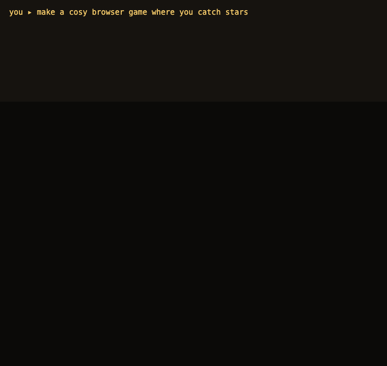

# Game Builder

An MCP server that helps any coding agent build games. Plug it into Claude Code, Codex, Cursor, Windsurf, Gemini CLI or any other MCP client, then say "make me a game where…". Your agent does the thinking and writing with its own model; Game Builder gives it the game know-how and tools. No API key needed.

It draws on the genres that make up most of the game market and the engines most used for games on GitHub, with open-source games to learn from in each genre.



*Real tool calls and output. The agent plans and scaffolds a 2D game, playtests it in a headless browser, then does the same for a first-person corridor. Regenerate with `uv run --with . --with pillow python docs/make_demo.py`.*

## What your agent gets

| Tool | What it does |
|---|---|
| `plan_game` | Picks a stack for the idea and returns the playbook plus the matching stack and genre guides, so the agent can pitch before building. |
| `get_guide` | Any stack or genre on demand: "godot", "unity", "three.js", "roguelike", "tower defense"… |
| `scaffold_game` | Writes a playable starter (2D web, Three.js first person, A-Frame world, Godot 4) — web starters include a GitHub Pages workflow; returns setup steps for Unity, Unreal, Bevy and other engines, and for multiplayer backends. Never overwrites a folder. |
| `image_prompt` | Writes a layout-exact prompt for ChatGPT or another image model, so generated sprite sheets line up with the code. |
| `check_game` | Finds missing asset files, JavaScript syntax errors and PNG sizes. |
| `playtest_game` | Plays a web game in a headless browser with the keys and clicks the agent chooses, then hands back a screenshot, errors, failed loads and the game state before and after, so the agent can see what it built. |
| `serve_game` | Serves the game at http://127.0.0.1 so you can play it. |

It also offers the guides as resources (`gamebuilder://playbook`, `gamebuilder://stacks`, `gamebuilder://genres`) and a `new_game` prompt.

| Stack | Good for |
|---|---|
| 2D web (Phaser, PixiJS, KAPLAY, canvas) | puzzle, casual, idle, card, dress-up, games that run from a link |
| 3D web (Three.js, Babylon.js, PlayCanvas) | first-person exploration, small 3D games in the browser, WebXR |
| Godot | most 2D games and small-to-mid 3D games on desktop, mobile and web |
| Unity | mobile, 3D action, VR/AR |
| Unreal | high-end 3D, shooters, open worlds |
| Bevy, MonoGame/FNA, libGDX, raylib, LÖVE, Defold, Pygame/Pyxel, Flutter Flame | code-first engines and frameworks by language |
| Ren'Py, Monogatari | visual novels and dating sims |
| Colyseus, Nakama, Socket.IO, boardgame.io | online multiplayer |

The genre guide covers 21 genres: action/platformer, roguelike, RPG, shooter, survival/crafting, strategy, tower defense, simulation/management, racing, fighting, sports, puzzle, casual mobile, card/deck builder, visual novel, dress-up, rhythm, idle, horror, party/social deduction and online multiplayer/MMO.

## Install

Needs [uv](https://docs.astral.sh/uv/) (or Python 3.10+ with pipx). The server is on PyPI as [`game-builder-mcp`](https://pypi.org/project/game-builder-mcp/) and runs with:

```
uvx game-builder-mcp
```

Add it to your agent:

**Claude Code**
```
claude mcp add game-builder -- uvx game-builder-mcp
```

**Codex** (`~/.codex/config.toml`)
```toml
[mcp_servers.game-builder]
command = "uvx"
args = ["game-builder-mcp"]
```

**Cursor** (`.cursor/mcp.json`), **Windsurf**, **Claude Desktop** and most other clients use the same JSON shape:
```json
{
  "mcpServers": {
    "game-builder": {
      "command": "uvx",
      "args": ["game-builder-mcp"]
    }
  }
}
```

**Gemini CLI** (`~/.gemini/settings.json`): the same `mcpServers` block.

To run the latest code from GitHub instead of the PyPI release, use `uvx --from git+https://github.com/wuisabel-gif/game-builder game-builder-mcp`.

## Use

Ask your agent, for example:

- "Use game-builder to make a Vampire Survivors-style game for the browser."
- "Make a Godot roguelike with procedurally generated rooms."
- "Build an online party game with room codes where friends join from their phones."
- "Set up a Unity tower defense game for mobile."
- "Write the image prompt for a 4-frame walk cycle, 256 × 256 per frame."

The agent plans, scaffolds, builds, checks and playtests the game itself, then serves it for you to play. The first playtest downloads a headless Chromium (about 150 MB).

## Develop

```
uv run --with . python tests/test_tools.py
```

Releases: bump `__version__` in `gamebuilder/__init__.py`, merge, then publish a GitHub release tagged `v<version>`. The Publish workflow builds the package and uploads it to PyPI with trusted publishing.

## License

MIT
